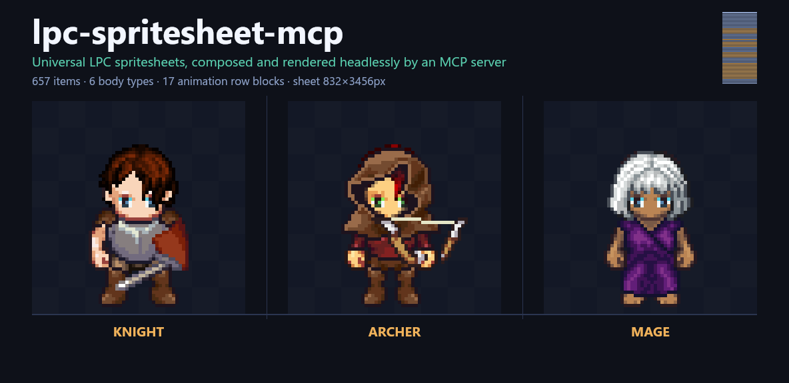
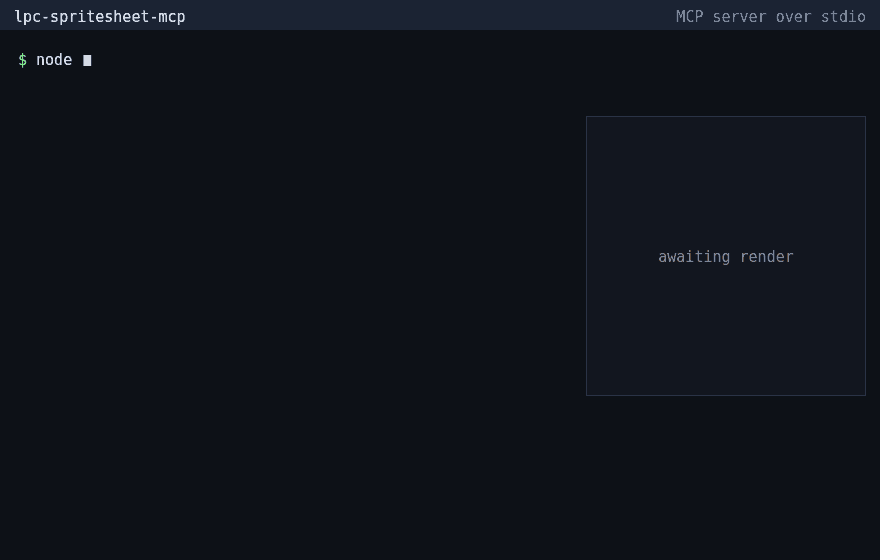
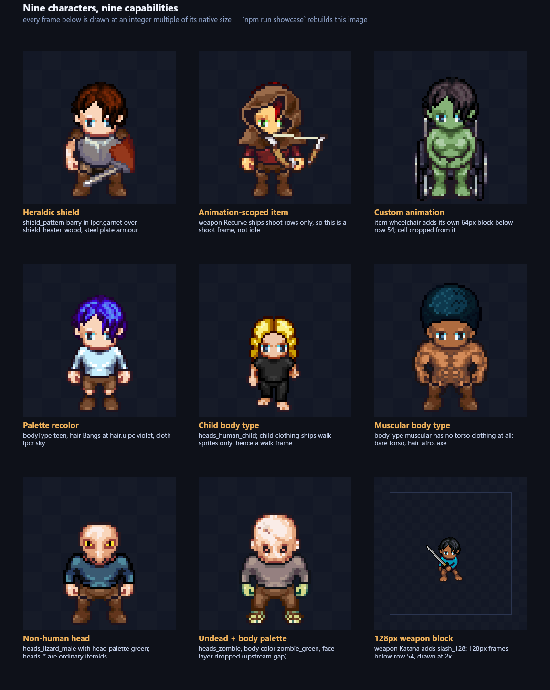
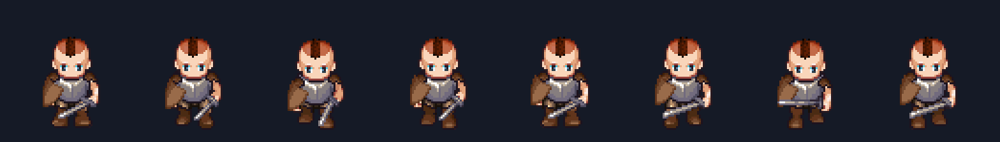
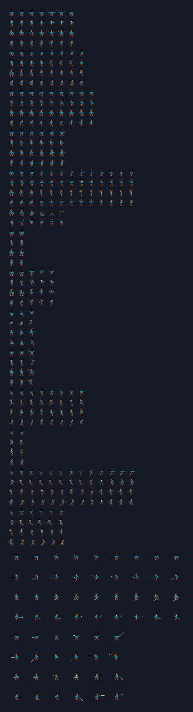
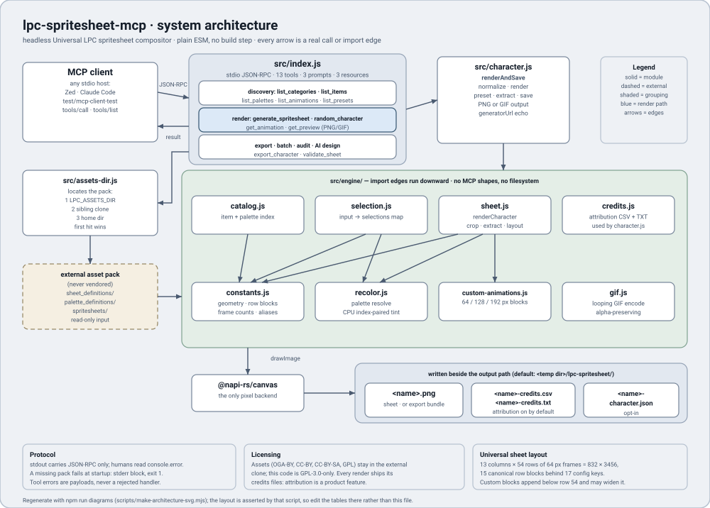

# lpc-spritesheet-mcp

<p align="center">
  
</p>

<p align="center">
  <a href="https://www.npmjs.com/package/lpc-spritesheet-mcp"></a>
  <a href="https://github.com/kanishka-namdeo/lpc-spritesheet-mcp/actions/workflows/ci.yml"></a>
  <a href="./LICENSE"></a>
  <a href="./package.json">= 20.11"></a>
</p>

**Give an AI agent a character artist's hands.** This is the
[Universal-LPC-Spritesheet-Character-Generator](https://github.com/LiberatedPixelCup/Universal-LPC-Spritesheet-Character-Generator)
web app re-implemented as a headless Node.js [MCP](https://modelcontextprotocol.io) server: an agent
describes a character, and gets back a game-ready 832×3456 spritesheet with the exact frame layout —
no browser, no screenshotting, no manual export button. Want to *see* it first? Previews come back
as **animated GIFs**. Want a whole village? **One seeded call.** Tired of discovering itemIds?
**Presets** and an **opt-in AI designer** start from plain language.

<p align="center">
  <br>
  <sub>A real session against <code>src/index.js</code> over stdio — every byte of JSON shown is what the server returned.<br>
  Only the typing timing is authored. Regenerate with <code>npm run demo</code> (<a href="./docs/img/demo-credits.csv">attribution</a>).</sub>
</p>

- **657 selectable items across 104 groups** on the current asset pack: 6 body types
  (male, female, teen, child, muscular, pregnant), 91 hairstyles, 45 heads (human, beast, reptile,
  undead, …), clothes, armor, 40 weapons, 9 shields with heraldic patterns, hats, capes, tails,
  wings, prostheses, wheelchairs.
- **Named palette recoloring** for skin, hair, eyes, cloth, metal and wood — 22 skintones,
  26 hair colors, a 75-color universal palette.
- **15 animation row blocks** on the standard sheet: 13 run in all four directions, `hurt` and
  `climb` ship a single facing — that is exactly the 54 rows. Plus **custom-animation blocks** for
  wheelchairs and 128/192px oversize weapons and tools.
- **Watch it walk.** `get_preview` returns one direction's playback cycle as a strip PNG or a
  **looping animated GIF** — inline in the conversation, correct LPC playback order, transparency
  preserved.
- **Surprise me, reproducibly.** `random_character` rolls a coherent character from any seed
  (same seed → same character, forever) with gear profiles from `bare` to `fancy`;
  `generate_batch` populates a whole NPC village in one call — sheets, previews, a contact grid,
  a manifest and one rolled-up credits file. **18 curated presets** (`knight`, `mage`,
  `blacksmith`, …) render in a single call via `preset: "<name>"`.
- **Engine-ready output.** Every render returns rows, frame counts, playback cycles and custom-block
  offsets, and `export_character` fans the same character out into per-animation or per-frame PNGs
  with an atlas in **five dialects** — TexturePacker/Phaser JSON Hash (with a cycle-correct
  `animations` map), Aseprite JSON (frameTags), Godot 4 `.tres` SpriteFrames, libGDX `.atlas`, and
  Unity pre-sliced `.png.meta` — plus a manifest, so a game engine never has to guess the
  layout or slice the sheet itself.
- **Opt-in AI design.** Configure `LPC_AI_API_KEY` and `design_character` turns a plain-language
  brief ("a tanned blacksmith with a leather apron and a hammer") into selections, colors, a
  rationale and a preview. Without the key the server stays **fully offline**: no network calls,
  no telemetry, and one environment variable (`LPC_ASSETS_DIR`).
- **Deterministic, and now proven.** `npm run golden` records SHA-256 hashes of seven canonical
  renders against a pinned asset-pack revision, and the test suite fails if a render drifts.
- **Attribution included.** Each sheet gets `-credits.csv` / `-credits.txt` beside it naming the
  authors and licenses of the art actually used.

The server ships **no art**. It reads a local clone of the upstream asset pack and renders it,
offline by default: no network calls, no telemetry, and one environment variable (`LPC_ASSETS_DIR`).

## Install

The server needs the upstream asset pack once. Any of these three lines does it — pick one:

```bash
git clone --depth 1 https://github.com/LiberatedPixelCup/Universal-LPC-Spritesheet-Character-Generator ~/.lpc-spritesheet/lpc-generator-src
lpc-spritesheet-setup           # same thing, via the npm bin after `npm install -g lpc-spritesheet-mcp`
npm run setup-assets            # same thing, from a checkout of this repo
```

Then wire the server into an MCP client: `npx -y lpc-spritesheet-mcp`, or `npm install -g` it and run
`lpc-spritesheet-mcp`. Prefer a checkout? `git clone` this repo and run `node src/index.js`. Updating
assets is a `git pull` in the pack clone.

The pack is looked up in this order, and the first valid entry wins:

1. `$LPC_ASSETS_DIR`
2. `../lpc-generator-src` (sibling of the package — the dev-checkout convention)
3. `~/.lpc-spritesheet/lpc-generator-src` (where the setup command above clones)

A valid pack contains both `sheet_definitions/` and `spritesheets/`. If none is found the server
prints what it searched for and exits — it will not start half-configured.

## Try it now

No MCP client required — the official protocol inspector drives the server from a shell. The
inspector starts the server with a clean environment, so if your asset pack lives outside the two
automatic locations, pass `-e LPC_ASSETS_DIR=<path>` (drop the flag when the pack is in
`~/.lpc-spritesheet/lpc-generator-src` or a sibling `lpc-generator-src/`):

```bash
# list the thirteen tools and their schemas
npx -y @modelcontextprotocol/inspector --cli node src/index.js --method tools/list \
  -e LPC_ASSETS_DIR=/path/to/lpc-generator-src

# or render an ANIMATED walk cycle: the GIF comes back inline
npx -y @modelcontextprotocol/inspector --cli node src/index.js --method tools/call \
  --tool-name get_preview --tool-arg animation=walk --tool-arg format=gif \
  --tool-arg scale=3 --tool-arg bodyType=female \
  -e LPC_ASSETS_DIR=/path/to/lpc-generator-src

# or roll a villager from a seed
npx -y @modelcontextprotocol/inspector --cli node src/index.js --method tools/call \
  --tool-name random_character --tool-arg seed=riverford-1 \
  -e LPC_ASSETS_DIR=/path/to/lpc-generator-src

# or drive it interactively: browse 657 items, call tools, view the result
npx @modelcontextprotocol/inspector node src/index.js
```

## MCP client configuration

All of these run the same stdio server. `LPC_ASSETS_DIR` is optional — omit it if the pack is in one
of the two automatic locations above. To enable the opt-in AI designer, add `LPC_AI_API_KEY`
(any OpenAI-compatible endpoint via `LPC_AI_BASE_URL`, default Dashscope's; model via `LPC_AI_MODEL`:
`qwen3.7-plus`, `kimi-k2.5` — the fast default — or `qwen3.6-plus`). Without the key the server is
fully offline and `design_character` answers with a setup error.

<details>
<summary>With the AI designer enabled (any client, env block)</summary>

```json
{
  "mcpServers": {
    "lpc-spritesheet": {
      "command": "npx",
      "args": ["-y", "lpc-spritesheet-mcp"],
      "env": {
        "LPC_AI_API_KEY": "sk-…",
        "LPC_AI_BASE_URL": "https://coding-intl.dashscope.aliyuncs.com/v1",
        "LPC_AI_MODEL": "kimi-k2.5"
      }
    }
  }
}
```
</details>

<details>
<summary>Claude Desktop (<code>claude_desktop_config.json</code>)</summary>

```json
{
  "mcpServers": {
    "lpc-spritesheet": {
      "command": "npx",
      "args": ["-y", "lpc-spritesheet-mcp"]
    }
  }
}
```
</details>

<details>
<summary>Claude Code (<code>claude mcp add</code>)</summary>

```bash
claude mcp add lpc-spritesheet -- npx -y lpc-spritesheet-mcp
```
</details>

<details>
<summary>Cursor / VS Code / generic stdio client, with a custom asset location</summary>

```json
{
  "mcpServers": {
    "lpc-spritesheet": {
      "command": "npx",
      "args": ["-y", "lpc-spritesheet-mcp"],
      "env": { "LPC_ASSETS_DIR": "D:/assets/lpc-generator-src" }
    }
  }
}
```
</details>

<details>
<summary>ZCode (<code>~/.zcode/cli/config.json</code>)</summary>

```json
{
  "mcp": {
    "servers": {
      "lpc-spritesheet": { "type": "stdio", "command": "npx", "args": ["-y", "lpc-spritesheet-mcp"] }
    }
  }
}
```
</details>

## The thirteen tools

| Tool | Purpose |
|---|---|
| `list_categories` | All selection groups (`body`, `hair`, `head`, `clothes`, `legs`, `shoes`, `weapon`, `hat`, `shield`, `tail`, `wings`, …) with item counts and whether they take colors. Start here. |
| `list_items` | One category: exact `itemId`s, display names, pre-sliced variants, valid recolors — deduplicated into a response-level `palettes` map. Filter with `search`, page with `limit`/`offset`, shrink with `fields`; the response is byte-budgeted, so check `truncated`/`nextOffset`. |
| `list_palettes` | Color names per material (`body`, `hair`, `eye`, `cloth`, `metal`, `wood`, `all`), with each material's default. |
| `list_animations` | The row layout of every animation (rows, frame counts, playback cycles, y-offsets) plus the custom blocks, which items provide them, and whether any item does. |
| `list_presets` | The curated preset library (knight, mage, blacksmith, farmer, rogue, royal, child, zombie, lizardfolk, wheelchair user, …) — renderable in one call with `preset: "<name>"`. |
| `generate_spritesheet` | Render the full universal sheet; returns the path, layout, warnings, credits, the upstream `generatorUrl` and the asset-pack revision. |
| `get_animation` | Render, then crop ONE animation into its own PNG — standard row block or custom block. |
| `get_preview` | Render, then crop one direction's playback cycle, upscaled 1–8× — as a strip PNG or a **looping animated GIF** (`format: "gif"`). Small enough to return inline, so you also get the image itself, not just a path. |
| `export_character` | Render, then fan out into a directory bundle: `sheet.png`, an atlas in one of **five dialects** (`texturepacker`, `aseprite`, `godot`, `libgdx`, `unity`) with cycle-correct playback sequences, `manifest.json`, and either one PNG per animation row block (`mode: "animation"`) or one per frame (`mode: "frames"`), plus credits. |
| `random_character` | Roll a coherent character from a seed — same seed, same character, forever. Gear profiles (`bare`/`civilian`/`soldier`/`fancy`), a completeness guarantee for core rows, ready-to-render selections/colors and an inline walk preview. |
| `generate_batch` | Populate a village in one call: N seeded characters → per-character sheets/previews/credits + `index.png` contact grid + `manifest.json` + one rolled-up credits file. |
| `design_character` | *(Opt-in, needs `LPC_AI_API_KEY`)* Turn a natural-language brief into ready-to-render selections/colors — catalog-grounded, validated, self-healing, with the model's rationale and an inline preview. |
| `validate_sheet` | Audit instead of render: the port's row-block tables against the pack (`layout`), a character's painted columns against the declared frame counts (`character`), or item definitions against what this port can resolve (`catalog`). Writes nothing; `ok: false` names what failed. |

Three **prompts** (`design-a-character`, `populate-a-village`, `export-for-my-engine`) script the
full agent workflows, and three **resources** (`lpc://sheet-layout`, `lpc://licensing`,
`lpc://presets`) serve reference material without a tool call.

The render tools share one argument block: `bodyType`, `preset`, `selections`, `colors`, `character`,
`match_body_color`, `include_credits`, `include_character_json` — plus `output_path` for the three
single-file tools and `output_dir` for `export_character`. Item IDs, display names, `"none"`, and
`{itemId, variant?, recolor?}` objects are all accepted per group. `character` takes the web app's
saved-character JSON (`{version: 2, selections}`, or the fuller document this server writes) or a v1
document with a `#sex=…&hair=…` state hash; explicit `selections`/`colors` merge on top. A v1 hash
that names a retired group or a stale color comes back as `warnings`, not a failure. Defaults mirror
the web app — light-skinned body, human male head, neutral expression (note the head default is *not*
body-aware).

### One call, start to finish

Ask your agent for *"a female archer with red hair, a teal hood and a recurve bow, walking toward
the viewer"*, or call the tool directly:

```jsonc
// tools/call → get_preview
{
  "bodyType": "female",
  "selections": { "hair": "Bangs", "clothes": "Longsleeve", "weapon": "Recurve", "hat": "Hood" },
  "colors": { "body": "amber", "hair": "red", "clothes": "teal", "eyes": "green" },
  "animation": "walk",
  "direction": "down",
  "scale": 3,
  "output_path": "sprites/archer-walk.png"
}
```

```jsonc
// ← result
{
  "output": "…/sprites/archer-walk.png",
  "bodyType": "female",
  "image": { "width": 1536, "height": 192, "frameSize": 192 },
  "animation": "walk", "direction": "down", "scale": 3,
  "frames": [1, 2, 3, 4, 5, 6, 7, 8],
  "warnings": [
    "weapon_ranged_bow_recurve: no sprite for row(s) walk, custom:walk_128 — those rows will be empty (2 missing)"
  ],
  "selections": {
    "body": "body (amber)", "head": "heads_human_male (light)", "expression": "face_neutral (light)",
    "hair": "hair_bangs (red)", "clothes": "torso_clothes_longsleeve (teal)",
    "weapon": "weapon_ranged_bow_recurve [light]", "hat": "hat_hood_cloth (brown)",
    "eyes": "heads_human_male [green] (color sub-selection)"
  },
  "credits": { "csv": "…/archer-walk-credits.csv", "txt": "…/archer-walk-credits.txt", "entries": 7 }
}
```

That warning is the feature working: the recurve bow's definition claims a walk cycle but the pack
ships no `walk.png` for it, so the engine renders the archer, leaves the bow's walk row empty, and
*tells you* — one aggregated message per item, never a failure. A test renders this exact call and
asserts these exact numbers and this exact warning, so the example above cannot rot. Note also that
`hat_hood_cloth` stayed brown: `colors.clothes` recolors the torso group, not every cloth item.

Relative `output_path`s resolve against the **server's** working directory, not the client's. Omit
`output_path` entirely and the sheet lands in `lpc-spritesheet/` under the OS temp directory, with a
timestamp suffix so two renders never overwrite each other.

### See it walk, in the same reply

```jsonc
// tools/call → get_preview  (same character, animated)
{
  "bodyType": "female",
  "selections": { "hair": "Bangs", "clothes": "Longsleeve", "weapon": "Recurve", "hat": "Hood" },
  "colors": { "body": "amber", "hair": "red", "clothes": "teal", "eyes": "green" },
  "animation": "walk", "direction": "down", "scale": 2,
  "format": "gif", "fps": 10
}
```

The GIF comes back inline (`image/gif`) *and* as a file — a looping walk cycle with the correct
LPC playback order, transparency preserved, a few KB for a 64px strip.

### One seed, one village

```jsonc
// tools/call → generate_batch
{ "count": 8, "seed": "riverford", "gear": "civilian" }
// ← 8 characters under one directory: 01/sheet.png, 01/preview.png, 01/character-credits.csv, …
//   + index.png (everyone at a glance) + manifest.json + batch-credits.csv
//   same seed → the same village, forever
```

### Or start from plain language (opt-in)

Set `LPC_AI_API_KEY` (any OpenAI-compatible endpoint via `LPC_AI_BASE_URL`; models
`qwen3.7-plus` / `kimi-k2.5` / `qwen3.6-plus`, default the fast `kimi-k2.5`) and:

```jsonc
// tools/call → design_character
{ "prompt": "a tanned female blacksmith with a leather apron and a hammer" }
// ← { bodyType: "female", selections: { … apron: "torso_aprons_apron_full", weapon: "tool_hammer" … },
//     colors: { body: "bronze", … }, rationale: "…", preview: { … inline walk strip … } }
```

## What comes out

<p align="center">
  
  <br><sub>Nine characters, nine capabilities — every one is a single tool call.</sub>
</p>

<p align="center">
  
  <br><sub><code>get_preview</code> — walk, down, 2×. The numbers are the cycle indices the tool returns.</sub>
</p>

<p align="center">
  
  <br><sub><code>generate_spritesheet</code> — the 64px walk row above the two 128px custom blocks the katana appends.
  The empty walk row is the honest case: this weapon ships no standard-row art, and the tool says so in <code>warnings</code>.</sub>
</p>

Rendering is fast enough to iterate on inside a conversation, but the number that matters is the first
call, not the steady state. Measured on Node 24 / Windows against pack revision `553ba75`: ~200 ms to
load the 657-item catalog, ~1.1 s from process start to the server's ready line, ~0.53 s for the first
832×3456 sheet while sprite PNGs come off disk, then **3–10 ms per further render** (including a weapon
sheet with 128px custom blocks) once the engine's image cache is warm — an animation crop ~8 ms, a
preview strip ~80–140 ms. A fresh MCP client pays the cold path once per process.

## How it works

<p align="center">
  
</p>

`src/index.js` is the MCP surface, `src/character.js` is the request pipeline, and `src/engine/` is a
headless port of the upstream renderer: `catalog` reads the pack's JSON definitions, `selection`
normalizes what the agent asked for, `recolor` does CPU palette-swapping, `sheet` composites the draw
calls into the frame grid, and `credits` collects attribution. The engine knows nothing about MCP.

[`docs/ARCHITECTURE.md`](./docs/ARCHITECTURE.md) has the upstream-to-here map, every intentional
divergence, and diagrams of the module graph, one render call, and where files land on disk.

## Sheet layout (stable)

13 columns × 54 rows of 64px frames = **832×3456**. Directions run up, left, down, right within each
row block:

| Animation | Row | Frames/dir | | Animation | Row | Frames/dir |
|---|---|---|---|---|---|---|
| `spellcast` | 0 | 7 | | `sit` | 30 | 3 |
| `thrust` | 4 | 8 | | `emote` | 34 | 3 |
| `walk` | 8 | 9 | | `run` | 38 | 8 |
| `slash` | 12 | 6 | | `combat_idle` | 42 | 2 |
| `shoot` | 16 | 13 | | `backslash` | 46 | 13 |
| `hurt` | 20 | 6 (1 row, down) | | `halfslash` | 50 | 6 |
| `climb` | 21 | 6 (1 row, up) | | | | |
| `idle` | 22 | 2 | | | | |
| `jump` | 26 | 5 | | | | |

`watering` and `1h_slash` are aliases that resolve onto another block's frames (`thrust` and
`backslash`); `combat` and `1h_backslash`/`1h_halfslash` **own** their rows and only differ in the
folder the pack ships them in. Custom blocks (64–192px frames) are appended below row 54 and can widen
the canvas to 1664px; the result payload reports every offset, so a consumer never has to derive them.

Known upstream asset gaps surface as `warnings`, one message per item — e.g. the `child` body ships
only hurt/idle/jump/sit/slash/walk, so its other rows come back empty by design, not by bug.

## Licensing — read this before you ship

- **This server's code:** GPL-3.0-only, because it derives from the GPL-3.0 upstream generator.
  See [LICENSE](./LICENSE).
- **The sprites it renders** come from the Liberated Pixel Cup pack: a mix of **OGA-BY 3.0,
  CC-BY-SA 3.0, CC-BY 3.0/4.0 and GPL** held by many artists. Every render writes
  `*-credits.csv` / `*-credits.txt` beside the PNG listing exactly the authors, licenses and links
  for the assets used. **Keep those files when you redistribute renders.**
- The images in this README are themselves renders, so they carry attribution too:
  [`docs/img/showcase-credits.csv`](./docs/img/showcase-credits.csv) and
  [`docs/img/demo-credits.csv`](./docs/img/demo-credits.csv).

## Development

```bash
npm install
npm run setup-assets    # or lpc-spritesheet-setup if you installed globally
npm test                # 140 passing items: 25 engine, 16+22 stdio MCP (old surface + new tools), 15 surface, 9 golden, 1 smoke, 52 module tests (gif/random/presets/atlas/url/ai)
npm run golden          # re-record test/golden.json after an intended rendering change
npm run assets          # regenerate every committed image (docs/img/)
```

`npm test` is the only automated gate — there is no lint, format or typecheck tooling in this repo, so
nothing else is claimed. CI runs the suite on Node 20 and 22 across Ubuntu and Windows, and asserts
that the server fails cleanly when the pack is missing.

See [CONTRIBUTING.md](./CONTRIBUTING.md), the issue templates under
[`.github/`](./.github), [`docs/ARCHITECTURE.md`](./docs/ARCHITECTURE.md) and
[`docs/capability-inventory.md`](./docs/capability-inventory.md) (everything the *upstream* generator
can do).

## Acknowledgements

Built on the [Universal-LPC-Spritesheet-Character-Generator](https://github.com/LiberatedPixelCup/Universal-LPC-Spritesheet-Character-Generator)
by Johannes Sjölund (wulax), bluecarrot16, Stephen Challener (Redshrike), ElizaWy, JaidynReiman and
the many LPC artists credited in its `CREDITS.csv` — this project exists to make their work usable
from AI agents. All sprites remain the property of their respective authors under the licenses noted
above.
