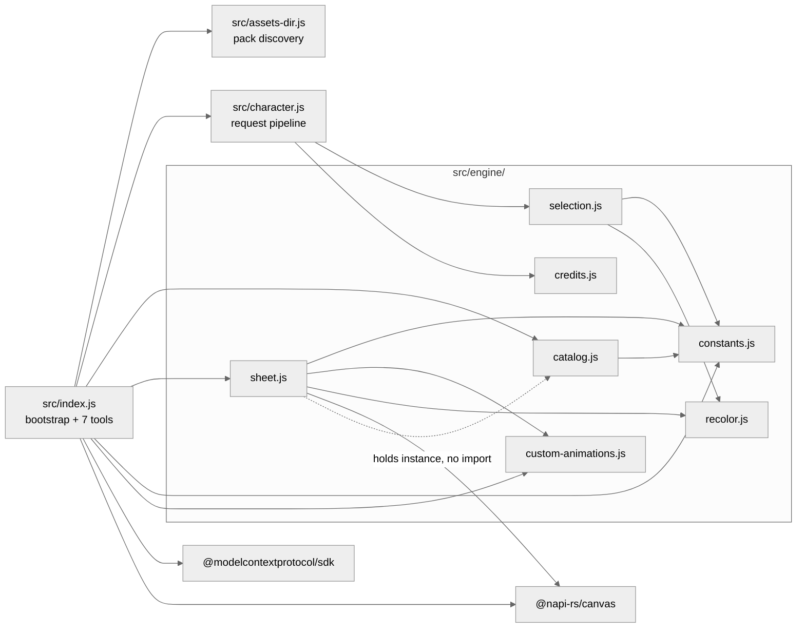
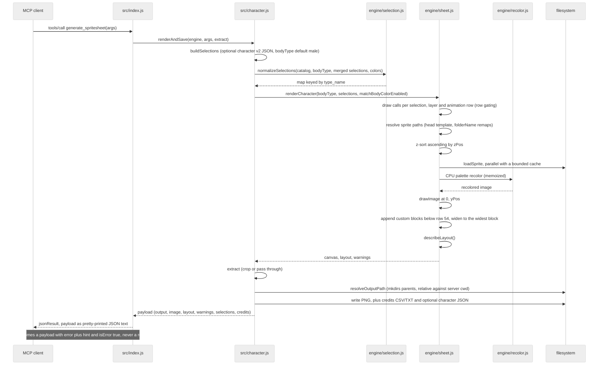
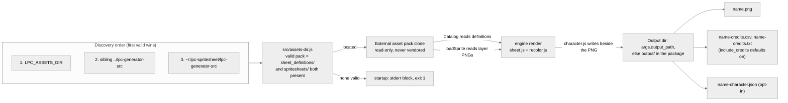

# Architecture notes (upstream → this server)

The upstream repo (cloned at `../lpc-generator-src`) is a Vite + Mithril + TypeScript
SPA. This server re-implements its runtime compositing in plain ESM JavaScript on
`@napi-rs/canvas`, reading the JSON definitions + PNG assets directly (no build step).
Port equivalence is covered by the test suite (`test/run-tests.mjs`).

The map below covers the whole shipped runtime, `src/index.js` and `src/character.js`
included. The layer above the engine has no upstream counterpart at all — see
"Local inventions".

## Upstream → here map

| Upstream | Here |
|---|---|
| `sources/state/constants.ts` | `src/engine/constants.js` (verbatim tables: FRAME_SIZE 64, 13 cols, 54 rows, ANIMATIONS + folderName remaps, ANIMATION_OFFSETS, ANIMATION_CONFIGS) |
| `tools/layout/universal-expanded.json` (13×54 cell mapping) | `src/engine/constants.js` (`ANIMATION_CONFIGS` rows/`num` + `ANIMATION_FRAME_COUNTS` columns) — geometry is duplicated in code because the port parses it from tool results, not from a layout file |
| `sources/custom-animations.ts` | `src/engine/custom-animations.js` (data extracted verbatim) |
| `scripts/generateSources/{items,item-helper,palettes}.ts` | `src/engine/catalog.js` (reads `sheet_definitions/` + `palette_definitions/` at startup; ports parseItem, getRequiredSexes, collectLayers, normalizeRecolors/expandRecolorPalettes) |
| `sources/state/palettes.ts` | `src/engine/recolor.js` (parseRecolorKey, getBasePalette, getTargetPalette, getMultiRecolors, getBodyColor, fixMissingRecolor, getPalettesFromMeta) |
| `sources/canvas/palette-recolor.ts` (CPU path) | `src/engine/recolor.js` (recolorImageCPU: index-paired palettes, ±1 tolerance, skip alpha 0; WebGL path intentionally not ported) |
| `sources/canvas/renderer.ts` (runRenderCharacter + custom areas) | `src/engine/sheet.js` (SpriteEngine.renderCharacter: drawCalls → z-sort → load → recolor → drawImage(0, yPos); custom blocks appended below SHEET_HEIGHT) |
| `sources/canvas/draw-frames.ts` | `src/engine/sheet.js` (drawFramesToCustomAnimation, drawSingleAnimSpriteToCustomAnimation, drawFrameToFrame) |
| `sources/canvas/renderer.ts:716 extractAnimationFromCanvas` | `src/engine/sheet.js:345 extractAnimation` (crops `row*num` rows at 64px, full 832 width) — backs `get_animation` |
| `sources/state/zip.ts:149-154` (custom-block slice at the running `y` below SHEET_HEIGHT) | `src/engine/sheet.js:362 extractCustomAnimation` (crop rect comes from `layout.custom`, so it also handles 128/192px blocks) — backs `get_animation` for custom names |
| `sources/canvas/preview-animation.ts` | `src/engine/sheet.js:381 extractPreviewStrip` (one direction's playback cycle laid out horizontally) — backs `get_preview` and the showcase |
| `sources/utils/zip-helpers.ts:363 extractFramesFromAnimation` | `src/engine/sheet.js:408 extractFrame` (single frame) — used by the showcase script, not by any tool |
| `sources/utils/credits.ts` | `src/engine/credits.js` (getAllCredits, creditsToCsv, creditsToTxt) |
| `sources/state/state.ts` selectDefaults | `src/engine/selection.js` (defaults: body + heads_human_male + face_neutral, all "light") |
| URL hash / saved JSON | tool args (`selections`, `colors`, `character` v2 JSON); hash parsing intentionally not ported |
| — **NONE** | `src/index.js` (shebang entry; bootstrap + the seven-tool MCP surface + response envelope). Upstream has no server: its UI state is the caller. |
| — **NONE** | `src/character.js` (`renderAndSave` request pipeline, `resolveOutputPath`, file writes). Upstream's equivalents are browser download helpers (`sources/models/download.ts`), which this port replaces with direct `fs` writes. |
| — **NONE** | `src/assets-dir.js` (asset-pack discovery). Upstream *is* the checkout, so the path is a build-time fact with no lookup logic. |
| — **NONE** | `src/engine/sheet.js:305 describeLayout`. Upstream keeps the row mapping in module-level state and in the `tools/layout/*.json` files; nothing returns it as data. |

## Local inventions

No upstream file corresponds to these. They exist because the port needs facts the web app gets
from UI state or from a layout file at click time.

- `src/index.js`, `src/character.js`, `src/assets-dir.js` — the MCP layer, the request pipeline,
  and pack discovery. `src/assets-dir.js` is the single shared implementation of the discovery
  order so the server, `test/` and `scripts/` can never disagree.
- `constants.js:ANIMATION_FRAME_COUNTS` — frames actually present per direction row, per canonical
  row block (15 blocks; verified against shipped PNG strip widths, not verbatim from upstream).
- `constants.js:ROW_BLOCK_ALIASES` (`watering`→`thrust`, `1h_slash`→`backslash`) and
  `resolveAnimationName` (`combat_idle`→`combat`) — alias resolution the UI performs implicitly.
- `constants.js:rowBlockFolder` / `rowBlockFrames` / `rowBlockYOffset` — the accessors that combine
  the alias map with the `ANIMATIONS.folderName` remaps to reach the right table key.
- `constants.js:SINGLE_ROW_DIRECTION` — which facing `hurt` (down) and `climb` (up) ship.
- The 54-row geometry decomposes as 13 blocks × 4 direction rows + `hurt` + `climb` × 1 row.
  `ANIMATION_CONFIGS` has 17 keys precisely because two of them (`watering`, `1h_slash`) are aliases.
- `custom-animations.js` holds 14 blocks: one at 64px (`wheelchair`), eight at 128px, five at 192px;
  the widest is 1664px (13 columns × 128: `tool_rod`, `backslash_128`).

## Tool surface → engine entry

The boundary is always `src/character.js`; `src/engine/` never sees a tool name, an argument name,
a payload shape, or the filesystem.

| Entry | Engine surface it reads |
|---|---|
| `list_categories`, `list_items`, `list_palettes` | `Catalog` only |
| `list_animations` | `ANIMATION_CONFIGS` + `customAnimations` + a `usedBy` reverse index built over `catalog.itemsById` in `index.js` |
| `generate_spritesheet` | `renderCharacter` → whole canvas + `describeLayout` output |
| `get_animation` | `renderCharacter` + `extractAnimation` (standard) or `extractCustomAnimation` (custom) |
| `get_preview` | `renderCharacter` + `extractPreviewStrip`, then nearest-neighbour upscale by `scale` 1–8 in `index.js` |
| `scripts/make-showcase.mjs` | `renderCharacter` + `extractFrame` / `extractPreviewStrip` directly, bypassing MCP |
| `test/run-tests.mjs` | the same engine methods in-process |

## Runtime shape

Diagram source is the contract here — GitHub renders fenced `mermaid` natively, so there is no
image binary to keep fresh. Keep diagrams small (well under mermaid's `maxTextSize: 50000` /
`maxEdges: 500`) and avoid mermaid 12-only block types (`block-beta`, `architecture-beta`,
`packet-beta`): GitHub pins an older renderer. The `theme: neutral` init keeps them legible in both
GitHub themes. `docs/img/architecture.svg` (from `npm run diagrams`) is the same system picture for
contexts that do not render mermaid, notably npm.

### Module dependencies (real import edges)

`constants.js`, `recolor.js`, `credits.js`, `custom-animations.js` and `assets-dir.js` are leaves:
they import no local module.

### One `generate_spritesheet` call

### Where things land on disk

The engine never writes files and the pack is never written to at all; only `src/character.js`
touches the filesystem, and only beside the requested output path.

## Invariants worth remembering

- Selections map is keyed by the item's `type_name`; sub-recolors (eyes) are their
  own map entry `{itemId, subId, recolor}` keyed by the recolor slot's type_name
  ("eyes") and are skipped by the renderer's drawCall loop (`subId` → recolor
  info only). Sub-selections are validated against `recolors[subId]`.
- Default recolor for a recolorable item is the upstream UI default: the FIRST
  entry of the slot's palette (cloth→brown, metal→ceramic, body→light), not the
  material meta's `base`.
- Selection group keys are validated against real type_names ("torso"/"feet"
  are rejected with guidance; shirts are "clothes", boots are "shoes").
- zPos: lower draws first (shadow 0, body 10, default 100).
- Row gating: `combat_idle` row ← items listing `combat`; `thrust` row ← `thrust`
  or `watering`; `backslash` ← `1h_slash`/`1h_backslash`; `halfslash` ← `1h_halfslash`.
- Recolorable items load the BASE png and tint at draw time; variant items load
  `.../<anim>/<variant>.png` (spaces→underscores). `recolors != null` ⇒ base png.
- `${head}` templates in layer paths resolve via the item's `replace_in_path`
  map using the selected head's display name (spaces→underscores) as the key.
- Custom blocks: heights add below 3456; canvas width = max(832, widest block).
  `custom_sprite` layers draw whole (or via single-anim remap when
  `sourceSingleAnimation`); all other layers' frames of the base animation are
  extracted per the block's frame grid.
- Known upstream asset gaps surface as `warnings`, aggregated one message per
  item (`"<itemId>: no sprite for row(s) hurt — those rows will be empty"`):
  child body ships only hurt/idle/jump/sit/slash/walk; rapier behind-layer lacks
  hurt; many weapons carry oversize custom blocks that widen the canvas.
- Single-row blocks face one way: hurt is down-only art, climb is up-only art —
  extraction accepts any direction and always returns that row.
- `combat` is the canonical config key (combat_idle is accepted as an alias);
  `watering`/`1h_*` rows report the frames/yOffset of the row block they share.
- Per-animation source PNGs are cropped to their real frame count (walk 9 cols,
  idle 2, combat_idle 2, …) — never assume 13 filled columns.
