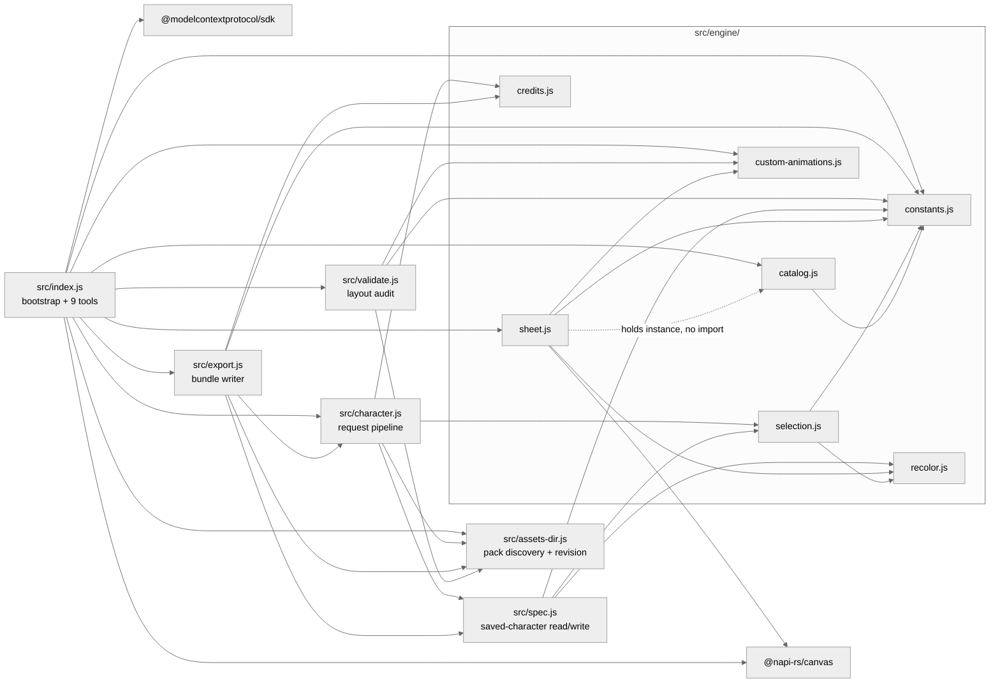
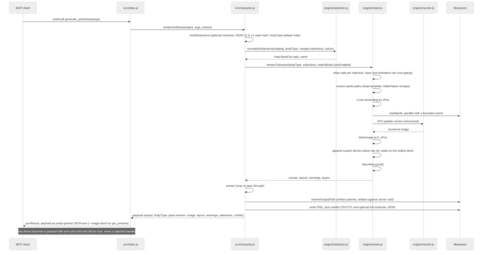
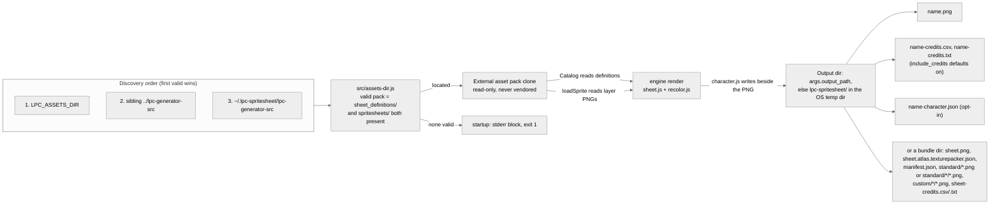

# Architecture notes (upstream → this server)

The upstream repo (cloned at `../lpc-generator-src`) is a Vite + Mithril + TypeScript
SPA. This server re-implements its runtime compositing in plain ESM JavaScript on
`@napi-rs/canvas`, reading the JSON definitions + PNG assets directly (no build step).
Port equivalence is covered by the test suite (`test/run-tests.mjs`).

The map below covers the whole shipped runtime, `src/index.js` and `src/character.js`
included. The layer above the engine has no upstream counterpart at all — see
"Local inventions".

## Upstream → here map

| Upstream | Here |
|---|---|
| `sources/state/constants.ts` | `src/engine/constants.js` (verbatim tables: FRAME_SIZE 64, 13 cols, 54 rows, ANIMATIONS + folderName remaps, ANIMATION_OFFSETS, ANIMATION_CONFIGS) |
| `tools/layout/universal-expanded.json` (13×54 cell mapping) | `src/engine/constants.js` (`ANIMATION_CONFIGS` rows/`num` + `ANIMATION_FRAME_COUNTS` columns) — geometry is duplicated in code because the port parses it from tool results, not from a layout file |
| `sources/custom-animations.ts` | `src/engine/custom-animations.js` (data extracted verbatim) |
| `scripts/generateSources/{items,item-helper,palettes}.ts` | `src/engine/catalog.js` (reads `sheet_definitions/` + `palette_definitions/` at startup; ports parseItem, getRequiredSexes, collectLayers, normalizeRecolors/expandRecolorPalettes) |
| `sources/state/palettes.ts` | `src/engine/recolor.js` (parseRecolorKey, getBasePalette, getTargetPalette, getMultiRecolors, getBodyColor, fixMissingRecolor, getPalettesFromMeta) |
| `sources/canvas/palette-recolor.ts` (CPU path) | `src/engine/recolor.js` (recolorImageCPU: index-paired palettes, ±1 tolerance, skip alpha 0; WebGL path intentionally not ported) |
| `sources/canvas/renderer.ts` (runRenderCharacter + custom areas) | `src/engine/sheet.js` (SpriteEngine.renderCharacter: drawCalls → z-sort → load → recolor → drawImage(0, yPos); custom blocks appended below SHEET_HEIGHT) |
| `sources/canvas/draw-frames.ts` | `src/engine/sheet.js` (drawFramesToCustomAnimation, drawSingleAnimSpriteToCustomAnimation, drawFrameToFrame) |
| `sources/canvas/renderer.ts:716 extractAnimationFromCanvas` | `src/engine/sheet.js:345 extractAnimation` (crops `row*num` rows at 64px, full 832 width) — backs `get_animation` |
| `sources/state/zip.ts:149-154` (custom-block slice at the running `y` below SHEET_HEIGHT) | `src/engine/sheet.js:362 extractCustomAnimation` (crop rect comes from `layout.custom`, so it also handles 128/192px blocks) — backs `get_animation` for custom names |
| `sources/canvas/preview-animation.ts` | `src/engine/sheet.js:381 extractPreviewStrip` (one direction's playback cycle laid out horizontally) — backs `get_preview` and the showcase |
| `sources/utils/zip-helpers.ts:363 extractFramesFromAnimation` | `src/engine/sheet.js:408 extractFrame` (single frame) — backs `export_character mode:"frames"` and the showcase script |
| `sources/utils/zip-helpers.ts` custom-block frame slice | `src/engine/sheet.js extractCustomFrame` (cell rect from `layout.custom`, so 128/192px blocks crop correctly) — backs `export_character mode:"frames"` |
| `sources/state/zip.ts:70-198` split-by-animation, `:250` split-by-item, `:647-690` export-individual-frames (all four ZIP modes) | `src/export.js` (directory tree, not a ZIP) — backs `export_character` |
| `sources/utils/fileName.ts` (zPos-prefixed names) | `src/export.js` uses `<animation>_<direction>_<n>` keys instead; the zPos-prefixed per-item mode is not ported |
| `sources/utils/credits.ts` | `src/engine/credits.js` (getAllCredits, creditsToCsv, creditsToTxt) |
| `sources/state/state.ts` selectDefaults | `src/engine/selection.js` (defaults: body + heads_human_male + face_neutral, all "light") |
| `sources/state/json.ts:15-29,144-156` (v2 export with `layers[]` + `credits[]` + flags) | `src/spec.js:buildCharacterSpec` — `layers[]` is assembled from the draw calls `renderCharacter` reports, so the document cannot disagree with the PNG it describes |
| `sources/state/json.ts:174-232` (v1 import) + `sources/state/hash.ts` (URL state) | `src/spec.js:readSavedCharacter` — **bounded port**: `sex`, `type_name=Name[_variant][_recolor]` and `_none` clearing, resolved through `selection.js:resolveItem`. Upstream's alias/wildcard tables are not reproduced; a name this pack cannot resolve becomes a `warning`, never a failed render |
| — **NONE** | `src/index.js` (shebang entry; bootstrap + the nine-tool MCP surface + response envelope). Upstream has no server: its UI state is the caller. |
| — **NONE** | `src/character.js` (`renderAndSave` request pipeline, `resolveOutputPath`, file writes). Upstream's equivalents are browser download helpers (`sources/models/download.ts`), which this port replaces with direct `fs` writes. |
| — **NONE** | `src/assets-dir.js` (asset-pack discovery). Upstream *is* the checkout, so the path is a build-time fact with no lookup logic. |
| — **NONE** | `src/engine/sheet.js:305 describeLayout`. Upstream keeps the row mapping in module-level state and in the `tools/layout/*.json` files; nothing returns it as data. |

## Local inventions

No upstream file corresponds to these. They exist because the port needs facts the web app gets
from UI state or from a layout file at click time.

- `src/index.js`, `src/character.js`, `src/assets-dir.js` — the MCP layer, the request pipeline,
  and pack discovery. `src/assets-dir.js` is the single shared implementation of the discovery
  order so the server, `test/` and `scripts/` can never disagree.
- `constants.js:ANIMATION_FRAME_COUNTS` — frames actually present per direction row, per canonical
  row block (15 blocks; verified against shipped PNG strip widths, not verbatim from upstream).
- `constants.js:ROW_BLOCK_ALIASES` (`watering`→`thrust`, `1h_slash`→`backslash`) and
  `resolveAnimationName` (`combat_idle`→`combat`) — alias resolution the UI performs implicitly.
- `constants.js:rowBlockFolder` / `rowBlockFrames` / `rowBlockYOffset` — the accessors that combine
  the alias map with the `ANIMATIONS.folderName` remaps to reach the right table key.
- `constants.js:SINGLE_ROW_DIRECTION` — which facing `hurt` (down) and `climb` (up) ship.
- The 54-row geometry decomposes as 13 blocks × 4 direction rows + `hurt` + `climb` × 1 row.
  `ANIMATION_CONFIGS` has 17 keys precisely because two of them (`watering`, `1h_slash`) are aliases.
- `custom-animations.js` holds 14 blocks: one at 64px (`wheelchair`), eight at 128px, five at 192px;
  the widest is 1664px (13 columns × 128: `tool_rod`, `backslash_128`).
- **Unreachable blocks are kept but not advertised.** Two of those 14 (`thrust_128`, `whip_oversize`)
  are defined upstream while no item in the pack references them. The definitions stay for parity;
  `Catalog.customAnimationProviders()` is the authority on reachability, `list_animations` marks each
  block `available`, and `SpriteEngine.customAnimationNames()` feeds only reachable names into error
  messages. `validate_sheet` reports the drift in both directions.
- `src/export.js` — the directory-bundle writer. Upstream ships the same content as four ZIP modes;
  a ZIP would add a dependency for a client that shares this filesystem, so the bundle is a tree plus
  `manifest.json`. Nothing in `src/engine/` writes files; the bundle writer is the caller.
- **TexturePacker JSON Hash is a dialect upstream does not have.** Chosen because it is the format
  Phaser and most importers read. `rotated:false` and `trimmed:false` are true statements about the
  engine's fixed grid. `anchor {0.5,0.5}` is not: the LPC grid carries no per-frame hot spot, so the
  atlas states a cell-centred pivot and `meta.pivotNote` says it is a local default. Frame durations
  are deliberately absent for the same reason — the pack ships no timing data, and inventing fps in a
  machine-readable file is how consumers end up trusting a number nobody measured.
- `src/validate.js` — the layout audit. Upstream has no equivalent; its maintainer asked for one
  (issue #588, after a shipped strip disagreed with its own definition). `warn` is used for the
  documented upstream asset-gap path, `fail` only where this port's own tables or the pack contradict
  them, and `test/golden-test.mjs` proves the audit can say no.
- `packRevision()` in `src/assets-dir.js` — the pack commit behind a result. Upstream is the checkout,
  so it never needed to say which version of itself it ran. `spawnSync git`, cached, returns null for a
  non-git pack and never throws.
- `list_items`' 12,000-byte response budget, `fields` selection and `bytes`/`truncated`/`nextOffset`
  keys. Upstream is a tree widget with virtual scrolling; a text protocol pays tokens per call.
- Tool `title`s, the four annotations, `outputSchema` + `structuredContent` on the six data tools, and
  the size-gated `type:"image"` block on `get_preview`. None of it exists upstream; it is what the MCP
  spec asks a server to say about itself.
- `ANIMATION_CONFIGS` reports 17 keys, `customAnimations` 14 blocks, and the universal sheet has 15
  row blocks. All three counts are right and mean different things; `validate_sheet layout` and
  `list_animations` are how a caller tells them apart.

## Tool surface → engine entry

The boundary is always `src/character.js`; `src/engine/` never sees a tool name, an argument name,
a payload shape, or the filesystem.

| Entry | Engine surface it reads |
|---|---|
| `list_categories`, `list_items`, `list_palettes` | `Catalog` only |
| `list_animations` | `ANIMATION_CONFIGS` + `customAnimations` + `Catalog.customAnimationProviders()` for `usedBy`/`available` |
| `generate_spritesheet` | `renderCharacter` → whole canvas + `describeLayout` output |
| `get_animation` | `renderCharacter` + `extractAnimation` (standard) or `extractCustomAnimation` (custom) |
| `get_preview` | `renderCharacter` + `extractPreviewStrip`, then nearest-neighbour upscale by `scale` 1–8 in `index.js` |
| `export_character` | `renderCharacter` + `extractAnimation` / `extractCustomAnimation` (mode `animation`) or `extractFrame` / `extractCustomFrame` (mode `frames`), with rects from `describeLayout`; writes via `src/export.js` |
| `validate_sheet` | tables + `Catalog` (`layout`, `catalog`) or an unsaved `renderCharacter` (`character`) — it never writes |
| `scripts/make-showcase.mjs`, `scripts/make-golden.mjs` | `renderCharacter` + crops directly, bypassing MCP |
| `test/run-tests.mjs` | the same engine methods in-process |

## Runtime shape

Diagram source is the contract here — GitHub renders fenced `mermaid` natively, so there is no
image binary to keep fresh. Keep diagrams small (well under mermaid's `maxTextSize: 50000` /
`maxEdges: 500`) and avoid mermaid 12-only block types (`block-beta`, `architecture-beta`,
`packet-beta`): GitHub pins an older renderer. The `theme: neutral` init keeps them legible in both
GitHub themes. `docs/img/architecture.svg` (from `npm run diagrams`) is the same system picture for
contexts that do not render mermaid, notably npm.

### Module dependencies (real import edges)

`constants.js`, `recolor.js`, `credits.js` and `custom-animations.js` are engine leaves: they import no
local module. `assets-dir.js` is the only module that touches the outside world besides `fs` — it
shells out to `git rev-parse` for the pack revision, caches the answer per directory, and returns null
instead of failing when the pack is not a checkout. `export.js` and `validate.js` sit on the
MCP-facing side of the boundary and are the only modules that write files or read tables for the
purpose of judging them; `src/engine/` still writes nothing.

### One `generate_spritesheet` call

### Where things land on disk

The engine never writes files and the pack is never written to at all. `src/character.js` writes the
single-file outputs beside the requested path; `src/export.js` is the only other writer and it stays
inside the `output_dir` it was given.

## Invariants worth remembering

- Selections map is keyed by the item's `type_name`; sub-recolors (eyes) are their
  own map entry `{itemId, subId, recolor}` keyed by the recolor slot's type_name
  ("eyes") and are skipped by the renderer's drawCall loop (`subId` → recolor
  info only). Sub-selections are validated against `recolors[subId]`.
- Default recolor for a recolorable item is the upstream UI default: the FIRST
  entry of the slot's palette (cloth→brown, metal→ceramic, body→light), not the
  material meta's `base`.
- Selection group keys are validated against real type_names ("torso"/"feet"
  are rejected with guidance; shirts are "clothes", boots are "shoes").
- zPos: lower draws first (shadow 0, body 10, default 100).
- Row gating: `combat_idle` row ← items listing `combat`; `thrust` row ← `thrust`
  or `watering`; `backslash` ← `1h_slash`/`1h_backslash`; `halfslash` ← `1h_halfslash`.
- Recolorable items load the BASE png and tint at draw time; variant items load
  `.../<anim>/<variant>.png` (spaces→underscores). `recolors != null` ⇒ base png.
- `${head}` templates in layer paths resolve via the item's `replace_in_path`
  map using the selected head's display name (spaces→underscores) as the key.
- Custom blocks: heights add below 3456; canvas width = max(832, widest block).
  `custom_sprite` layers draw whole (or via single-anim remap when
  `sourceSingleAnimation`); all other layers' frames of the base animation are
  extracted per the block's frame grid.
- Known upstream asset gaps surface as `warnings`, aggregated one message per
  item (`"<itemId>: no sprite for row(s) hurt — those rows will be empty"`):
  child body ships only hurt/idle/jump/sit/slash/walk; rapier behind-layer lacks
  hurt; many weapons carry oversize custom blocks that widen the canvas.
- Single-row blocks face one way: hurt is down-only art, climb is up-only art —
  extraction accepts any direction and always returns that row.
- `combat` is the canonical config key (combat_idle is accepted as an alias);
  `watering`/`1h_*` rows report the frames/yOffset of the row block they share.
- Per-animation source PNGs are cropped to their real frame count (walk 9 cols,
  idle 2, combat_idle 2, …) — never assume 13 filled columns.
- Warning text is part of the contract: the same character must produce the same strings every run.
  Missing-row lists are ordered by sheet position, not by the order sprite loads settle, and
  `test/golden-test.mjs` compares those arrays across processes.
- A result is only reproducible if the pack behind it is named, so render, bundle and audit payloads
  all carry `pack: { revision }`. `test/golden.json` pins that revision for the byte hashes; CI
  checks out the same ref.
- `list_items` never returns more than `LIST_ITEMS_BYTE_BUDGET` serialized bytes unless a single item
  alone exceeds it, in which case it says so with `oversizedItem`. `bytes` describes the text the
  caller actually receives, budget keys included.
- Where a tool offers a per-item argument it removes the ones that cannot apply rather than ignoring
  them: `export_character` has no `output_path` (it takes `output_dir`), `validate_sheet` has no
  output or sidecar arguments at all. A caller that passes one gets an unknown-argument warning.
- `renderCharacter`'s `layers` inventory is derived from the draw calls that painted, so a character
  document can never claim support for a row block the sheet left empty.
