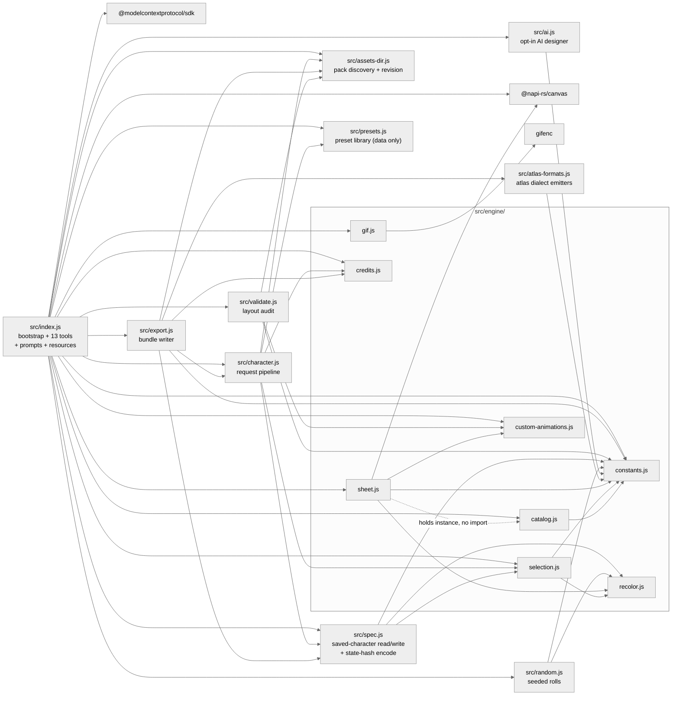
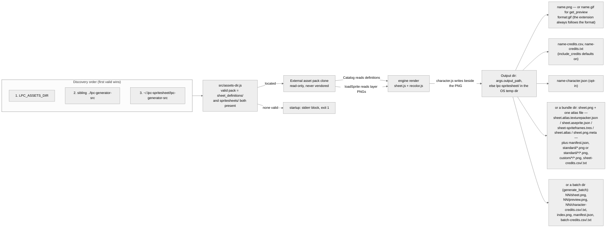

# Architecture notes (upstream → this server)

The upstream repo (cloned at `../lpc-generator-src`) is a Vite + Mithril + TypeScript
SPA. This server re-implements its runtime compositing in plain ESM JavaScript on
`@napi-rs/canvas`, reading the JSON definitions + PNG assets directly (no build step).
Port equivalence is covered by the test suite (`test/run-tests.mjs`).

The map below covers the whole shipped runtime, `src/index.js` and `src/character.js`
included. The layer above the engine has no upstream counterpart at all — see
"Local inventions".

## Upstream → here map

| Upstream | Here |
|---|---|
| `sources/state/constants.ts` | `src/engine/constants.js` (verbatim tables: FRAME_SIZE 64, 13 cols, 54 rows, ANIMATIONS + folderName remaps, ANIMATION_OFFSETS, ANIMATION_CONFIGS) |
| `tools/layout/universal-expanded.json` (13×54 cell mapping) | `src/engine/constants.js` (`ANIMATION_CONFIGS` rows/`num` + `ANIMATION_FRAME_COUNTS` columns) — geometry is duplicated in code because the port parses it from tool results, not from a layout file |
| `sources/custom-animations.ts` | `src/engine/custom-animations.js` (data extracted verbatim) |
| `scripts/generateSources/{items,item-helper,palettes}.ts` | `src/engine/catalog.js` (reads `sheet_definitions/` + `palette_definitions/` at startup; ports parseItem, getRequiredSexes, collectLayers, normalizeRecolors/expandRecolorPalettes) |
| `sources/state/palettes.ts` | `src/engine/recolor.js` (parseRecolorKey, getBasePalette, getTargetPalette, getMultiRecolors, getBodyColor, fixMissingRecolor, getPalettesFromMeta) |
| `sources/canvas/palette-recolor.ts` (CPU path) | `src/engine/recolor.js` (recolorImageCPU: index-paired palettes, ±1 tolerance, skip alpha 0; WebGL path intentionally not ported) |
| `sources/canvas/renderer.ts` (runRenderCharacter + custom areas) | `src/engine/sheet.js` (SpriteEngine.renderCharacter: drawCalls → z-sort → load → recolor → drawImage(0, yPos); custom blocks appended below SHEET_HEIGHT) |
| `sources/canvas/draw-frames.ts` | `src/engine/sheet.js` (drawFramesToCustomAnimation, drawSingleAnimSpriteToCustomAnimation, drawFrameToFrame) |
| `sources/canvas/renderer.ts:716 extractAnimationFromCanvas` | `src/engine/sheet.js:390 extractAnimation` (crops `row*num` rows at 64px, full 832 width) — backs `get_animation` |
| `sources/state/zip.ts:149-154` (custom-block slice at the running `y` below SHEET_HEIGHT) | `src/engine/sheet.js:407 extractCustomAnimation` (crop rect comes from `layout.custom`, so it also handles 128/192px blocks) — backs `get_animation` for custom names |
| `sources/canvas/preview-animation.ts` | `src/engine/sheet.js:453 extractPreviewStrip` (one direction's playback cycle laid out horizontally) — backs `get_preview` (the PNG strip and the GIF frames alike) and the showcase |
| `sources/utils/zip-helpers.ts:363 extractFramesFromAnimation` | `src/engine/sheet.js:480 extractFrame` (single frame) — backs `export_character mode:"frames"`, the batch contact grid and the showcase script |
| `sources/utils/zip-helpers.ts` custom-block frame slice | `src/engine/sheet.js extractCustomFrame` (cell rect from `layout.custom`, so 128/192px blocks crop correctly) — backs `export_character mode:"frames"` |
| `sources/state/zip.ts:70-198` split-by-animation, `:250` split-by-item, `:647-690` export-individual-frames (all four ZIP modes) | `src/export.js` (directory tree, not a ZIP) + `src/atlas-formats.js` (five atlas dialects) — backs `export_character`; upstream ships no importer metadata at all, so every atlas dialect is a local addition over the same crops |
| `sources/utils/fileName.ts` (zPos-prefixed names) | `src/export.js` uses `<animation>_<direction>_<n>` keys instead; the zPos-prefixed per-item mode is not ported |
| `sources/utils/credits.ts` | `src/engine/credits.js` (getAllCredits, creditsToCsv, creditsToTxt) |
| `sources/state/state.ts` selectDefaults | `src/engine/selection.js` (defaults: body + heads_human_male + face_neutral, all "light") |
| `sources/state/json.ts:15-29,144-156` (v2 export with `layers[]` + `credits[]` + flags) | `src/spec.js:buildCharacterSpec` — `layers[]` is assembled from the draw calls `renderCharacter` reports, so the document cannot disagree with the PNG it describes |
| `sources/state/json.ts:174-232` (v1 import) + `sources/state/hash.ts` (URL state) | `src/spec.js:readSavedCharacter` — **bounded port**: `sex`, `type_name=Name[_variant][_recolor]` and `_none` clearing, resolved through `selection.js:resolveItem`. Upstream's alias/wildcard tables are not reproduced; a name this pack cannot resolve becomes a `warning`, never a failed render |
| `sources/state/hash.ts:181-249` `getHashParamsforSelections` + `:116-125` `createHashStringFromParams` (the shareable-URL *encoder*) | `src/spec.js` `toStateHash` / `generatorUrl` — the encoder half of the v1 state hash: name-based values (hash.ts:235), `sex=` first (hash.ts:189), variant/recolor tails (hash.ts:237-242), colors folded into those tails, `eyes=` keyed by the recolor slot's type_name and named by its label (hash.ts:231). Every render payload now carries the resulting web-app URL |
| — **NONE** | `src/index.js` (shebang entry; bootstrap + the thirteen-tool MCP surface, 3 prompts, 3 resources + response envelope). Upstream has no server: its UI state is the caller. |
| — **NONE** | `src/character.js` (`renderAndSave` request pipeline, `resolveOutputPath`, file writes). Upstream's equivalents are browser download helpers (`sources/models/download.ts`), which this port replaces with direct `fs` writes. |
| — **NONE** | `src/assets-dir.js` (asset-pack discovery). Upstream *is* the checkout, so the path is a build-time fact with no lookup logic. |
| — **NONE** | `src/presets.js` — 18 curated archetypes. Upstream starts every session from the same defaults; it has no named-character concept. |
| — **NONE** | `src/random.js` — the seeded roller. Upstream has no randomize button anywhere in its UI. |
| — **NONE** | `src/ai.js` — the opt-in AI designer. Upstream has no AI; the web app's user is the designer. |
| — **NONE** | `src/engine/gif.js` — animated-GIF encoding for previews. Upstream animates a `<canvas>` in the browser and never encodes a GIF. |
| — **NONE** | `generate_batch` (in `src/index.js`) — N seeded characters, per-character directories, contact grid, rolled-up credits. Upstream exports one character at a time. |
| — **NONE** | `src/engine/sheet.js:340 describeLayout`. Upstream keeps the row mapping in module-level state and in the `tools/layout/*.json` files; nothing returns it as data. |

## Local inventions

No upstream file corresponds to these. They exist because the port needs facts the web app gets
from UI state or from a layout file at click time — or they ship capability the web app never
had (random rolls, GIF previews, engine atlases, AI design).

- `src/index.js`, `src/character.js`, `src/assets-dir.js` — the MCP layer, the request pipeline,
  and pack discovery. `src/assets-dir.js` is the single shared implementation of the discovery
  order so the server, `test/` and `scripts/` can never disagree.
- `constants.js:ANIMATION_FRAME_COUNTS` — frames actually present per direction row, per canonical
  row block (15 blocks; verified against shipped PNG strip widths, not verbatim from upstream).
- `constants.js:ROW_BLOCK_ALIASES` (`watering`→`thrust`, `1h_slash`→`backslash`) and
  `resolveAnimationName` (`combat_idle`→`combat`) — alias resolution the UI performs implicitly.
- `constants.js:rowBlockFolder` / `rowBlockFrames` / `rowBlockYOffset` — the accessors that combine
  the alias map with the `ANIMATIONS.folderName` remaps to reach the right table key.
- `constants.js:SINGLE_ROW_DIRECTION` — which facing `hurt` (down) and `climb` (up) ship.
- The 54-row geometry decomposes as 13 blocks × 4 direction rows + `hurt` + `climb` × 1 row.
  `ANIMATION_CONFIGS` has 17 keys precisely because two of them (`watering`, `1h_slash`) are aliases.
- `custom-animations.js` holds 14 blocks: one at 64px (`wheelchair`), eight at 128px, five at 192px;
  the widest is 1664px (13 columns × 128: `tool_rod`, `backslash_128`).
- **Unreachable blocks are kept but not advertised.** Two of those 14 (`thrust_128`, `whip_oversize`)
  are defined upstream while no item in the pack references them. The definitions stay for parity;
  `Catalog.customAnimationProviders()` is the authority on reachability, `list_animations` marks each
  block `available`, and `SpriteEngine.customAnimationNames()` feeds only reachable names into error
  messages. `validate_sheet` reports the drift in both directions.
- `src/export.js` — the directory-bundle writer. Upstream ships the same content as four ZIP modes;
  a ZIP would add a dependency for a client that shares this filesystem, so the bundle is a tree plus
  `manifest.json`. Nothing in `src/engine/` writes files; the bundle writer is the caller.
- **The atlas dialects are inventions upstream does not have.** Upstream ships PNGs and ZIPs, no
  importer metadata. `src/atlas-formats.js` serializes one shared frame model five ways —
  TexturePacker JSON Hash (the default, what Phaser and most importers read), Aseprite data JSON,
  Godot 4 `.tres` SpriteFrames, libGDX `.atlas` text, Unity `.png.meta` — and each emitter's doc
  comment cites the format source it was verified against (Aseprite CLI docs; Godot's own
  demo-project files + docs + the LPCAnimatedSprite2D plugin; libGDX `TextureAtlas.java`; Unity's
  ScriptReference cross-checked with a working emitter). `rotated:false` and `trimmed:false` are
  true statements about the engine's fixed grid. The LPC grid carries no per-frame hot spot, so
  the TexturePacker atlas states a cell-centred pivot and `meta.pivotNote` says it is a local
  default, while the Unity slices use feet pivots (`alignment:9`, `pivot {0.5,0}`). Every atlas
  plus the manifest carries an `animations` map — cycle-correct playback sequences straight from
  `ANIMATION_CONFIGS` cycles — so a consumer never re-derives the upstream playback order (walk
  plays 2–9, idle holds 0,0,1, sit/emote hold each frame five steps). Timing is the one field with
  no pack truth: the TexturePacker map omits durations entirely, while the Aseprite and Godot
  dialects write their formats' required timing fields (100 ms frames; 10 fps clips) to match the
  web app's default tick.
- `src/presets.js` — 18 curated, render-verified archetypes (villager … barbarian), expressed in
  tool-input form; the test suite renders each one against the pinned pack. The render tools
  accept `preset`, and `buildSelections` layers preset → saved-character document → explicit
  `selections`/`colors` in that order.
- `src/random.js` — the seeded random generator. `cyrb128` → `mulberry32` is pure 32-bit integer
  math, so a seed names exactly one character forever. Gear profiles (`bare`/`civilian`/
  `soldier`/`fancy`) tune how armed and fancy a roll is; `complete_only` keeps always-visible
  groups to items that paint both walk and idle, relaxing with a note when the pack has no
  complete item instead of shipping an empty group. `randomCharacters` derives per-character
  seeds (`<seed>:<i>`), which is what makes a `generate_batch` village reproducible.
- `src/engine/gif.js` — `encodeAnimatedGif`, the animated-preview encoder (gifenc moved from
  devDependencies to dependencies for it). gifenc's `rgba4444` + `oneBitAlpha` quantization
  collapses every transparent pixel onto one `[0,0,0,0]` palette entry, which each frame's
  graphic-control extension then flags; the NETSCAPE2.0 extension rides frame one with repeat 0
  (loop forever). The encoder is byte-deterministic by construction.
- `src/ai.js` — the opt-in AI designer behind `design_character`. The module never reads
  `process.env` and performs network I/O only inside `chatCompletion` (injectable `fetchImpl`,
  abort-based timeout, one retry without `response_format` on a 400 that names it). The catalog
  digest (byte-budgeted, ~7.5k chars) grounds the model in real itemIds and color names;
  `parseCharacterSpec` extracts balanced-brace JSON from prose replies; `designCharacter`
  supports one `repair` round that feeds a failed proposal plus the valid itemIds back to the
  model.
- The three MCP prompts (`design-a-character`, `populate-a-village`, `export-for-my-engine`) and
  three resources (`lpc://sheet-layout`, `lpc://licensing`, `lpc://presets`) — scripted workflows
  and reference material. Server capabilities grew from `{tools}` to `{tools, prompts,
  resources}`.
- `generatorUrl` on every render payload — `GENERATOR_APP_URL` + the state hash, so a character
  made here re-opens in the live web app for further tweaking. The encoder is the mapped
  `hash.ts` port above; linking every result back to the app is the local part.
- `generate_batch` — the NPC village: N seeded characters each in their own directory
  (`NN/sheet.png`, `NN/preview.png`, `NN/character-credits.*`), plus `index.png` (a contact grid
  of every character's walk-down frame), one batch `manifest.json`, and a rolled-up
  `batch-credits.csv/.txt`.
- `src/validate.js` — the layout audit. Upstream has no equivalent; its maintainer asked for one
  (issue #588, after a shipped strip disagreed with its own definition). `warn` is used for the
  documented upstream asset-gap path, `fail` only where this port's own tables or the pack contradict
  them, and `test/golden-test.mjs` proves the audit can say no.
- `packRevision()` in `src/assets-dir.js` — the pack commit behind a result. Upstream is the checkout,
  so it never needed to say which version of itself it ran. `spawnSync git`, cached, returns null for a
  non-git pack and never throws.
- `list_items`' 12,000-byte response budget, `fields` selection and `bytes`/`truncated`/`nextOffset`
  keys. Upstream is a tree widget with virtual scrolling; a text protocol pays tokens per call.
- Tool `title`s, the four annotations, `outputSchema` + `structuredContent` on the eight data tools,
  and the size-gated inline `type:"image"` block on `get_preview`, `random_character` and
  `design_character` previews (PNG or GIF bytes, annotated `audience:["user"]`). None of it exists
  upstream; it is what the MCP spec asks a server to say about itself.
- `ANIMATION_CONFIGS` reports 17 keys, `customAnimations` 14 blocks, and the universal sheet has 15
  row blocks. All three counts are right and mean different things; `validate_sheet layout` and
  `list_animations` are how a caller tells them apart.

## Tool surface → engine entry

Render requests enter through `src/character.js` (`generate_batch` drives the engine directly —
it writes its own tree); `src/engine/` never sees a tool name, an argument name, a payload shape,
or the filesystem.

| Entry | Engine surface it reads |
|---|---|
| `list_categories`, `list_items`, `list_palettes` | `Catalog` only |
| `list_animations` | `ANIMATION_CONFIGS` + `customAnimations` + `Catalog.customAnimationProviders()` for `usedBy`/`available` |
| `generate_spritesheet` | `renderCharacter` → whole canvas + `describeLayout` output |
| `get_animation` | `renderCharacter` + `extractAnimation` (standard) or `extractCustomAnimation` (custom) |
| `get_preview` | `renderCharacter` + `extractPreviewStrip`, then nearest-neighbour upscale by `scale` 1–8 in `index.js`; `format:"gif"` additionally cuts the scaled strip into per-frame canvases and encodes them with `engine/gif.js` `encodeAnimatedGif` (uniform `fps` tick — the cycle is the timing table) |
| `export_character` | `renderCharacter` + `extractAnimation` / `extractCustomAnimation` (mode `animation`) or `extractFrame` / `extractCustomFrame` (mode `frames`), with rects from `describeLayout`; writes via `src/export.js` |
| `validate_sheet` | tables + `Catalog` (`layout`, `catalog`) or an unsaved `renderCharacter` (`character`) — it never writes |
| `list_presets` | `src/presets.js` only — no engine involvement |
| `random_character` | `randomCharacter` (`src/random.js`) reads `Catalog` only; the default inline preview rides `renderAndSave` → `renderCharacter` + `extractPreviewStrip` |
| `generate_batch` | `randomCharacter` per character, then direct `renderCharacter` / `extractPreviewStrip` / `extractFrame` calls (bypasses the `character.js` save path — it writes its own tree) |
| `design_character` | `src/ai.js` (`buildCatalogDigest` → `designCharacter` → `parseCharacterSpec`, opt-in via `aiConfigFromEnv`), the proposal validated through `normalizeSelections` with one `repair` retry; the preview is `renderCharacter` + `extractPreviewStrip` |
| `scripts/make-showcase.mjs`, `scripts/make-golden.mjs` | `renderCharacter` + crops directly, bypassing MCP |
| `test/run-tests.mjs` | the same engine methods in-process |

## Runtime shape

Diagram source is the contract here — GitHub renders fenced `mermaid` natively, so there is no
image binary to keep fresh. Keep diagrams small (well under mermaid's `maxTextSize: 50000` /
`maxEdges: 500`) and avoid mermaid 12-only block types (`block-beta`, `architecture-beta`,
`packet-beta`): GitHub pins an older renderer. The `theme: neutral` init keeps them legible in both
GitHub themes. `docs/img/architecture.svg` (from `npm run diagrams`) is the same system picture for
contexts that do not render mermaid, notably npm.

### Module dependencies (real import edges)



`constants.js`, `recolor.js`, `credits.js`, `custom-animations.js` and `gif.js` are engine leaves:
`gif.js` imports only the external `gifenc`, the other four import no local module at all. On the
MCP-facing side `presets.js` imports nothing — it is pure data — and `atlas-formats.js` imports
only `constants.js` (plus `node:crypto` for Unity's deterministic guid). `assets-dir.js` shells
out to `git rev-parse` for the pack revision, caches the answer per directory, and returns null
instead of failing when the pack is not a checkout; it and `ai.js` are the only modules that touch
the outside world beyond `fs`, and `ai.js` only when the operator opts in. `validate.js` reads
tables for the purpose of judging them; the file writers are `character.js` (single-file
outputs), `export.js` (bundles) and the `generate_batch` handler in `index.js` (batch trees);
`src/engine/` still writes nothing.

### One `generate_spritesheet` call

```mermaid
%%{init: {"theme": "neutral"}}%%
sequenceDiagram
  accTitle: Sequence of one generate_spritesheet call
  accDescr: The MCP client's tool call enters the server, the shared pipeline normalizes selections, the engine composites the sheet on canvas, and the pipeline writes the PNG plus attribution files before the JSON payload returns to the client.

  participant C as MCP client
  participant I as src/index.js
  participant P as src/character.js
  participant S as engine/selection.js
  participant E as engine/sheet.js
  participant R as engine/recolor.js
  participant F as filesystem

  C->>I: tools/call generate_spritesheet(args)
  I->>P: renderAndSave(engine, args, extract)
  P->>P: buildSelections (optional preset, then character JSON v2 or v1 state hash, then explicit selections/colors; bodyType default male)
  P->>S: normalizeSelections(catalog, bodyType, merged selections, colors)
  S-->>P: map keyed by type_name
  P->>E: renderCharacter(bodyType, selections, matchBodyColorEnabled)
  E->>E: draw calls per selection, layer and animation row (row gating)
  E->>E: resolve sprite paths (head template, folderName remaps)
  E->>E: z-sort ascending by zPos
  E->>F: loadSprite, parallel with a bounded cache
  E->>R: CPU palette recolor (memoized)
  R-->>E: recolored image
  E->>E: drawImage at 0, yPos
  E->>E: append custom blocks below row 54, widen to the widest block
  E->>E: describeLayout()
  E-->>P: canvas, layout, warnings, layers
  P->>P: extract (crop or pass through)
  P->>F: resolveOutputPath (mkdirs parents, relative against server cwd)
  P->>F: write PNG, plus credits CSV/TXT and optional full character JSON
  P-->>I: payload (output, format, bodyType, generatorUrl, pack.revision, image, layout, warnings, selections, credits)
  I-->>C: jsonResult, payload as pretty-printed JSON text (+ inline image block for get_preview / random_character / design_character)
  Note over I,C: any throw becomes a payload with error plus hint and isError true, never a rejected handler
```

### Where things land on disk



The engine never writes files and the pack is never written to at all. `src/character.js` writes the
single-file outputs beside the requested path; `src/export.js` (bundles) and the `generate_batch`
handler in `src/index.js` (batch trees) are the only other writers, and each stays inside the
`output_dir` it was given.

## Invariants worth remembering

- Selections map is keyed by the item's `type_name`; sub-recolors (eyes) are their
  own map entry `{itemId, subId, recolor}` keyed by the recolor slot's type_name
  ("eyes") and are skipped by the renderer's drawCall loop (`subId` → recolor
  info only). Sub-selections are validated against `recolors[subId]`.
- Default recolor for a recolorable item is the upstream UI default: the FIRST
  entry of the slot's palette (cloth→brown, metal→ceramic, body→light), not the
  material meta's `base`.
- Selection group keys are validated against real type_names ("torso"/"feet"
  are rejected with guidance; shirts are "clothes", boots are "shoes").
- zPos: lower draws first (shadow 0, body 10, default 100).
- Row gating: `combat_idle` row ← items listing `combat`; `thrust` row ← `thrust`
  or `watering`; `backslash` ← `1h_slash`/`1h_backslash`; `halfslash` ← `1h_halfslash`.
- Recolorable items load the BASE png and tint at draw time; variant items load
  `.../<anim>/<variant>.png` (spaces→underscores). `recolors != null` ⇒ base png.
- `${head}` templates in layer paths resolve via the item's `replace_in_path`
  map using the selected head's display name (spaces→underscores) as the key.
- Custom blocks: heights add below 3456; canvas width = max(832, widest block).
  `custom_sprite` layers draw whole (or via single-anim remap when
  `sourceSingleAnimation`); all other layers' frames of the base animation are
  extracted per the block's frame grid.
- Known upstream asset gaps surface as `warnings`, aggregated one message per
  item (`"<itemId>: no sprite for row(s) hurt — those rows will be empty"`):
  child body ships only hurt/idle/jump/sit/slash/walk; rapier behind-layer lacks
  hurt; many weapons carry oversize custom blocks that widen the canvas.
- Single-row blocks face one way: hurt is down-only art, climb is up-only art —
  extraction accepts any direction and always returns that row.
- `combat` is the canonical config key (combat_idle is accepted as an alias);
  `watering`/`1h_*` rows report the frames/yOffset of the row block they share.
- Per-animation source PNGs are cropped to their real frame count (walk 9 cols,
  idle 2, combat_idle 2, …) — never assume 13 filled columns.
- Warning text is part of the contract: the same character must produce the same strings every run.
  Missing-row lists are ordered by sheet position, not by the order sprite loads settle, and
  `test/golden-test.mjs` compares those arrays across processes.
- A result is only reproducible if the pack behind it is named, so render, bundle and audit payloads
  all carry `pack: { revision }`. `test/golden.json` pins that revision for the byte hashes; CI
  checks out the same ref.
- `list_items` never returns more than `LIST_ITEMS_BYTE_BUDGET` serialized bytes unless a single item
  alone exceeds it, in which case it says so with `oversizedItem`. `bytes` describes the text the
  caller actually receives, budget keys included.
- Where a tool offers a per-item argument it removes the ones that cannot apply rather than ignoring
  them: `export_character` has no `output_path` (it takes `output_dir`), `validate_sheet` has no
  output or sidecar arguments at all. A caller that passes one gets an unknown-argument warning.
- `renderCharacter`'s `layers` inventory is derived from the draw calls that painted, so a character
  document can never claim support for a row block the sheet left empty.
- The atlas emitters are pure functions of their arguments — no filesystem, clock or random — and
  two calls with the same frame list produce byte-identical output (`test/atlas-formats-test.mjs`
  re-emits and compares). Unity's `guid` is SHA-256 of the character name + sheet size rather than
  a random UUID for the same reason: a regenerated sheet keeps its identity.
- The random generator is deterministic by contract: no `Math.random`, no `Date`, no environment
  input anywhere in `src/random.js`. Its pools draw from catalog maps built by sorted directory
  walks, so iteration order — and therefore the character a seed produces — is stable per pack
  revision (a pack bump can change the pools, so `pack.revision` in the payload is part of a
  random character's identity).
- Offline by default, AI by opt-in. All network I/O lives in `src/ai.js` `chatCompletion`
  (injectable `fetchImpl`, abort-based timeout, one retry without `response_format` on a 400 that
  names it); `src/index.js` reads the env once through `aiConfigFromEnv`, and without
  `LPC_AI_API_KEY` the `design_character` tool returns a setup error and the server never opens a
  socket.
- A GIF preview's timing table is the cycle: `get_preview` `format:"gif"` gives every frame the
  same tick (`fps`, default 10 = the web app's default), and that IS correct playback, because the
  LPC cycle already encodes per-frame holds (idle 0,0,1; sit ×5). Per-frame durations would
  re-encode information the cycle already carries.
- `toStateHash` is upstream parity, not a lookalike: it ports `hash.ts:181-249`
  (`getHashParamsforSelections`) faithfully — name-based values, `sex=` first, raw variant strings
  percent-encoded, `eyes=` keyed by the recolor slot's type_name and named by its label. Parity
  was verified differentially against a literal transcription of the upstream value construction
  across every item × variant × recolor selection shape in the pinned pack (53,604 shapes, 0
  mismatches), and `test/url-test.mjs` byte-pins the emitted format.
